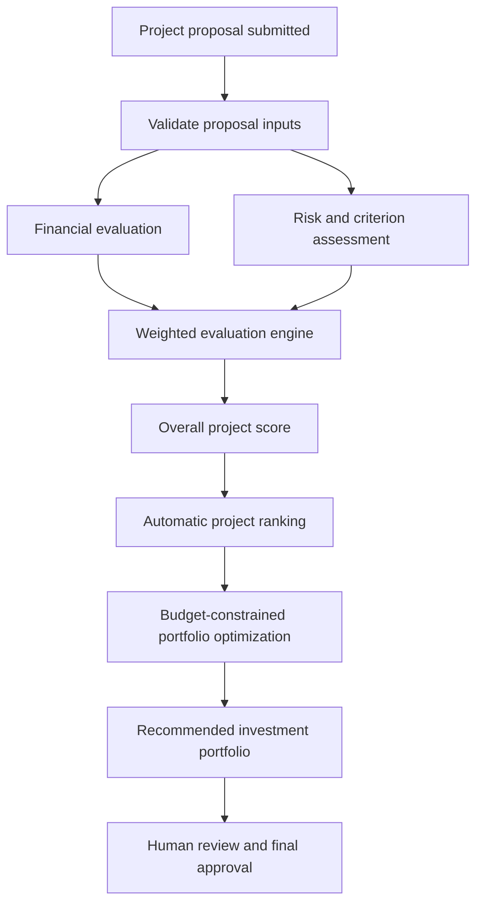

# PEIRS — Project Evaluation & Investment Ranking System

**An automated, explainable decision-support system for evaluating project proposals, ranking investment opportunities, and selecting a portfolio within a limited budget.**

PEIRS helps an organization compare competing projects using a consistent set of financial, strategic, technical, impact, risk, and implementation criteria. It converts proposal inputs into comparable scores, produces a ranked project list, and uses budget-constrained optimization to recommend a combination of projects.

> **Decision-support notice:** PEIRS automates calculations, scoring, ranking, and portfolio recommendations. It does not make or authorize the final investment decision. The quality of its output depends on the accuracy of the assumptions entered by project proposers.

---

## 1. The problem

Organizations often receive more project proposals than they can fund. Comparing proposals manually can lead to inconsistent scoring, subjective prioritization, and difficulty identifying the best combination of projects under a fixed budget.

PEIRS addresses this by providing a repeatable evaluation process:

- Assess each proposal using the same evaluation criteria.
- Calculate key financial indicators from submitted estimates.
- Convert qualitative assessment inputs into a weighted score.
- Rank projects using a consistent scoring method.
- Recommend a portfolio that maximizes the combined project scores without exceeding the available budget.

## 2. Solution overview

PEIRS is a lightweight Python web application. A user submits a project proposal through the interface. The evaluation engine calculates financial metrics, criterion-level scores, and an overall score. The rankings page orders all evaluated projects, while the budget optimizer selects a combination of projects under the specified investment limit.



## 3. Key features

| Module | What it does | Output |
|---|---|---|
| Project submission | Captures project details, financial estimates, assessment inputs, and risk estimates | Saved and evaluated proposal |
| Financial evaluation | Calculates NPV, IRR, ROI, BCR, and payback period | Financial indicators |
| Multi-criteria evaluation | Applies configurable weights to six evaluation criteria | Score out of 100 |
| Risk assessment | Uses probability and impact ratings to calculate risk exposure | Risk score and risk-resilience criterion score |
| Project rankings | Sorts evaluated projects by overall score, with NPV as a tie-breaker | Ranked project list |
| Budget optimizer | Applies 0/1 knapsack dynamic programming to project scores and investment requirements | Recommended project portfolio |
| Dashboard | Summarizes projects, investment requirements, scores, and financial attractiveness | Visual overview |
| Criteria configuration | Allows authorized project evaluators to adjust criterion weights | Updated weights for future evaluations |

## 4. Evaluation methodology

PEIRS uses a **deterministic and explainable weighted scoring model**. It does not currently use a trained machine-learning model or generative AI.

### 4.1 Financial evaluation

The application uses the proposal's initial investment, estimated annual revenue/benefit, annual operating cost, and project duration.

Let:

- (I) = initial investment
- (R) = estimated annual revenue or benefit
- (C) = estimated annual operating cost
- (n) = project duration in years
- (r) = discount rate (8% by default)
- (NCF = R-C) = annual net cash flow

**Net Present Value (NPV)**

[
NPV=-I+\sum_{t=1}^{n}\frac{R-C}{(1+r)^t}
]

NPV estimates the present value of the project's expected net cash flows after accounting for the initial investment.

**Return on Investment (ROI)**

[
ROI=\frac{n(R-C)-I}{I}\times100
]

ROI represents the total undiscounted net return over the project duration relative to the initial investment.

**Benefit-Cost Ratio (BCR)**

[
BCR=\frac{\sum_{t=1}^{n}\frac{R}{(1+r)^t}}{I+\sum_{t=1}^{n}\frac{C}{(1+r)^t}}
]

A BCR above 1 indicates that the discounted benefits exceed the discounted investment and operating costs under the supplied assumptions.

**Payback period**

[
Payback=\frac{I}{R-C}
]

This is shown when annual net cash flow is positive. It is a simple payback estimate and does not account for discounting.

**Internal Rate of Return (IRR)**

IRR is estimated numerically using a bisection method to find the discount rate at which NPV is zero. It is displayed as unavailable when a root cannot be reliably bracketed by the implementation.

### 4.2 Evaluation criteria and default weights

Each criterion receives a score between 0 and 100. The default weights are:

| Evaluation criterion | Weight | Basis |
|---|---:|---|
| Financial Viability | 25% | Derived from NPV, ROI, and BCR |
| Strategic Alignment | 20% | Project proposer's 0–100 assessment |
| Technical Feasibility | 15% | Project proposer's 0–100 assessment |
| Expected Impact | 15% | Project proposer's 0–100 assessment |
| Risk Assessment | 15% | Derived from probability and impact ratings |
| Implementation Feasibility | 10% | Timeline-based proxy |
| **Total** | **100%** | |

The weights can be changed in the **Evaluation Criteria** section. The application validates that the six criteria are present and the weights total exactly 100%. Updated weights apply to new evaluations; previously saved evaluation results are not silently recalculated.

### 4.3 Financial viability score

The current implementation combines normalized financial indicators:

[
FinancialScore =
0.50F_{NPV}+0.25F_{ROI}+0.25F_{BCR}
]

Where:

- (F_{NPV}=clamp(50+50\times NPV/I,0,100))
- (F_{ROI}=clamp(50+ROI/2,0,100))
- (F_{BCR}=clamp(50\times BCR,0,100))

Here, `clamp(x, 0, 100)` limits a value to the 0–100 range.

### 4.4 Risk assessment

The proposal form captures:

- Risk probability: 1 (low) to 5 (high)
- Risk impact: 1 (low) to 5 (high)

The model calculates:

[
RiskExposure=Probability\times Impact
]

[
RiskScore=\frac{RiskExposure}{25}\times100
]

The Risk Assessment criterion score is (100-RiskScore). A higher risk score therefore reduces the project's overall evaluation score.

### 4.5 Implementation feasibility

Implementation feasibility is currently a transparent timeline-based proxy:

[
ImplementationScore=clamp(100-2.5\times max(0,Months-12),20,100)
]

Projects with an implementation timeline of 12 months or less receive 100 for this criterion. The score decreases for longer timelines, subject to a lower bound of 20.

### 4.6 Overall weighted score

For criterion scores (S_i) and weights (W_i):

[
OverallScore=\sum_{i=1}^{6}S_i\times\frac{W_i}{100}
]

The result is a score between 0 and 100. Projects are sorted by overall score in descending order. NPV is used as the tie-breaker.

## 5. Budget-constrained investment optimization

A high-ranked project is not necessarily affordable, and selecting projects one at a time may not produce the best combination under a fixed budget.

PEIRS uses the **0/1 Knapsack dynamic programming algorithm** to select a subset of projects:

- Each project is either selected once or not selected.
- The sum of selected project investments must not exceed the available budget.
- The objective is to maximize the sum of the selected projects' evaluation scores.
- Investment amounts are conservatively rounded up to discrete budget units to keep the dynamic-programming state space manageable.

The optimizer displays the recommended projects, total selected investment, number of projects, investment-weighted portfolio score, budget utilization, and unallocated budget. Because costs are rounded up for optimization, a feasible combination may occasionally be omitted if it fits the exact budget but not the rounded budget units.

The displayed portfolio score is calculated as:

[
PortfolioScore=\frac{\sum Investment_i\times Score_i}{\sum Investment_i}
]

This is an investment-weighted average of the selected projects' individual scores. It is distinct from the sum of scores used as the optimizer's objective.

## 6. Technology stack

| Technology | Purpose |
|---|---|
| Python | Application and evaluation logic |
| Streamlit | Interactive web interface |
| SQLite | Persistent local project and settings storage |
| Pandas | Tabular data processing and presentation |
| Plotly | Interactive dashboard charts |
| unittest | Automated unit tests for evaluation logic |

The application intentionally uses a single Python codebase and local SQLite database. It does not require a separate Java/Node backend, frontend build, database server, or Docker environment.

## 7. Application structure

```text
Project-evaluation-and-investment-ranking-system/
├── app.py                  # Streamlit UI and application pages
├── engine.py               # Financial calculations, scoring, ranking, optimization
├── database.py             # SQLite setup and persistence
├── test_engine.py          # Unit tests for core evaluation logic
├── requirements.txt        # Python dependencies
├── .streamlit/
│   └── config.toml         # Application theme and Streamlit configuration
├── .gitignore              # Excludes local environment and database files
└── README.md
```

## 8. Installation and execution

### Prerequisites

- Python 3.10 or later
- Git

### Clone the repository

```bash
git clone https://github.com/atharva9282/Project-evaluation-and-investment-ranking-system.git
cd Project-evaluation-and-investment-ranking-system
```

### Create and activate a virtual environment

**macOS / Linux**

```bash
python3 -m venv .venv
source .venv/bin/activate
```

**Windows PowerShell**

```powershell
py -m venv .venv
.venv\Scripts\Activate.ps1
```

### Install dependencies

```bash
python -m pip install --upgrade pip
pip install -r requirements.txt
```

### Run the application

```bash
streamlit run app.py
```

Streamlit will print a local URL, normally:

```text
http://localhost:8501
```

Open that address in a browser.

## 9. Suggested evaluator demonstration

The following sequence demonstrates the complete system workflow:

1. **Open Dashboard:** Show the overview and current project statistics.
2. **Load sample projects:** Use the sidebar's sample-data action to populate illustrative projects if the database is empty.
3. **Submit Project:** Enter a new proposal with investment, annual revenue, operating cost, duration, strategic alignment, technical feasibility, expected impact, implementation timeline, and risk ratings.
4. **Show automatic evaluation:** Submit the proposal and review the generated NPV, IRR, ROI, BCR, payback, risk score, and overall score.
5. **Open Rankings:** Show that the newly evaluated project is automatically included in the ranked list. Select a project to inspect its criterion-level breakdown.
6. **Open Evaluation Criteria:** Explain the six criteria and demonstrate how their weights can be configured to total 100%.
7. **Open Budget Optimizer:** Enter an investment budget, run optimization, and show the recommended portfolio, total investment, portfolio score, and budget utilization.
8. **Conclude with decision support:** Explain that the system provides a consistent, quantitative recommendation while final approval remains with the responsible investment authority.

## 10. Sample data

The sidebar includes a **Load sample projects** action. It inserts a small set of illustrative projects only when the projects table is empty. These records are synthetic examples intended for demonstration and testing; they are not actual institutional investment proposals or verified financial data.

## 11. Testing

Run the core evaluation tests from the repository root:

```bash
python -m unittest -v
```

The tests cover financial metric generation, IRR calculation, evaluation-weight validation, ranking order, and budget optimizer constraints.

## 12. Data storage and privacy

- SQLite creates the local database file `peirs.db` automatically in the project directory.
- Project proposals and evaluation results are stored locally in this database.
- Evaluation criteria weights are stored in the same database.
- The database file is excluded from Git through `.gitignore`; user-entered project data is not intended to be committed to the repository.
- The current prototype does not implement user authentication, role-based access control, encrypted document storage, or production deployment controls. Do not expose it publicly with confidential project or financial information.

## 13. Assumptions, limitations, and future scope

PEIRS is a working prototype for structured project screening. Its results should be interpreted in light of the following limitations:

- Financial calculations use the values and constant annual cash flows supplied by the user. Inflation, taxes, financing structure, depreciation, working capital, residual value, and changing annual cash flows are not currently modeled.
- The discount rate is fixed at 8% in the current implementation.
- Strategic alignment, technical feasibility, and expected impact are user-entered assessments, not independently verified findings.
- Risk is summarized using one probability-impact pair; a detailed multi-risk register is not currently implemented.
- Implementation feasibility uses project duration as a proxy and does not assess resource availability or dependencies.
- The current application is a local prototype. It does not provide authentication, multi-user permissions, approval workflows, audit trails, or document verification.
- The scoring model is rule-based and deterministic. It does not train on historical investment outcomes and does not use an AI model to validate proposal claims.

Potential future enhancements include evidence/document uploads, multiple risks per project, configurable discount rates and cash-flow schedules, role-based access, approval workflows, audit history, sensitivity analysis, and integration with verified institutional data.

## 14. Responsible use

PEIRS is intended to improve consistency, transparency, and efficiency in the preliminary evaluation of project proposals. It should support—not replace—professional financial analysis and institutional governance. Before allocating funds, decision-makers should validate proposal assumptions, supporting evidence, risk assessments, affordability, legal obligations, and strategic fit.

---

**Repository:** [Project-evaluation-and-investment-ranking-system](https://github.com/atharva9282/Project-evaluation-and-investment-ranking-system)
